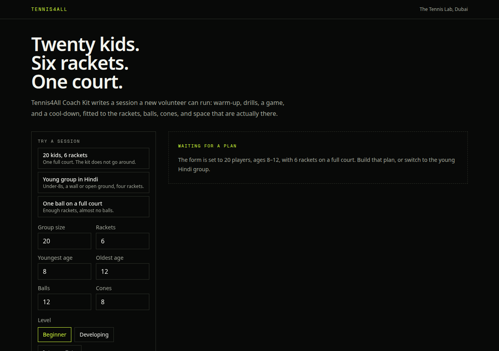
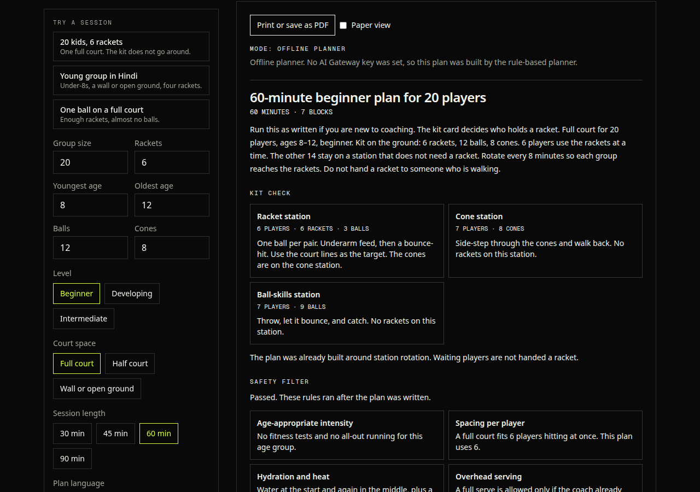
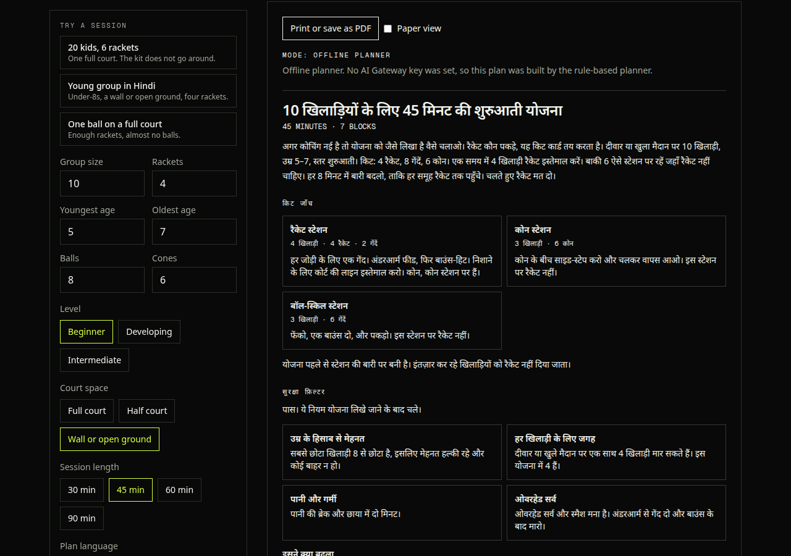
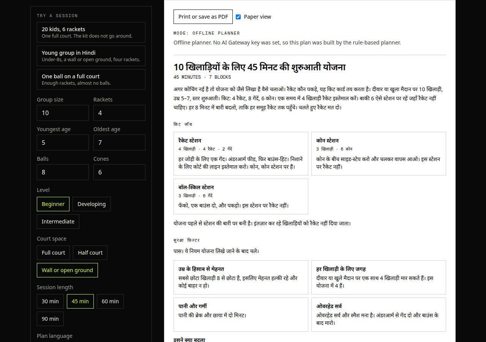
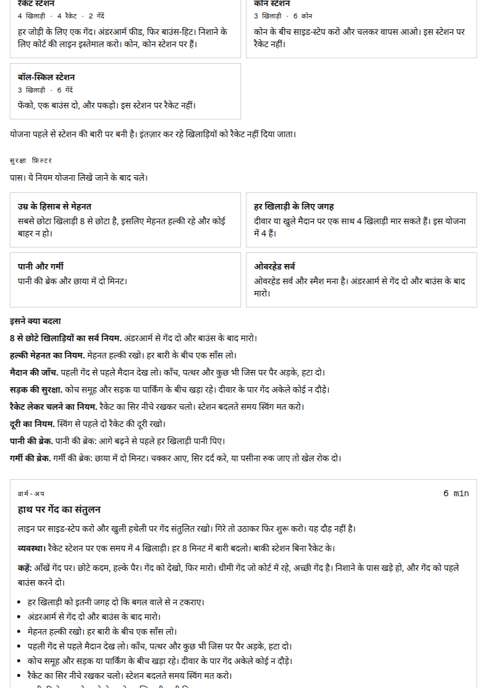
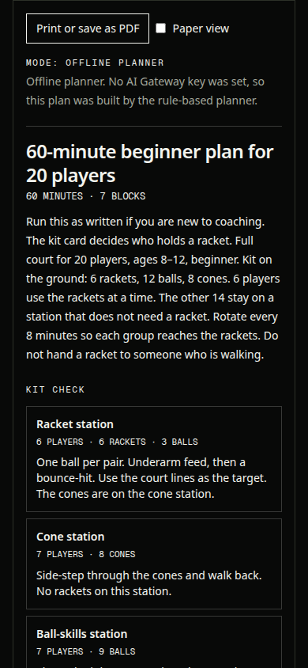

# Tennis4All Coach Kit

A session planner for volunteer and community tennis coaches. It turns a group, an age range, a level, the kit on the ground, the space, and the time available into a session a new coach can run: a warm-up, three or four drills, a game, and a cool-down.

It was built for [Tennis4All](https://the-tennislab.com/tennis4all), The Tennis Lab's programme in Dubai that collects used rackets, balls, and shoes for kids who cannot afford them. The other half of that work is the coach who shows up with whatever was donated. A new coach at a Delhi NGO might have 20 children, 6 rackets, and one court. This kit is for that hour.

Built by Tejas Gupta. [rallymate.me](https://rallymate.me) · [the-tennislab.com/tennis4all](https://the-tennislab.com/tennis4all)

## What you put in

- Group size and age range
- Level: beginner, developing, or intermediate
- Kit: rackets, balls, cones
- Space: full court, half court, or wall / open ground
- Length: 30, 45, 60, or 90 minutes
- Language: English or Hindi

No names, no accounts, and no database. Do not type in anything about a real child.

## What you get

Each block has a time, a setup, how to organise the group, cues the coach can say out loud, and safety notes. The plan is fitted to the kit and the space.

**Kit check.** If there are fewer rackets than players, or the court cannot hold everyone at once, the plan rotates stations. A full court keeps six players hitting. A half court, wall, or open patch keeps four. Everyone else throws, moves through cones, or works on ready position. Rackets are not handed out while people are walking, and a station never uses more equipment than the bag contains. With no rackets, the session is movement and ball skills, not a pretend rally.

**Safety filter.** A rule-based check runs after the plan is written, including when a model wrote it. It covers age-appropriate intensity, how many players may swing at once, water and heat breaks, and a ban on overhead serving for groups whose youngest player is under 8. It rewrites unsafe lines and adds the breaks that were missing, then lists what it changed. The plan says whether it passed.

**Print.** "Print or save as PDF" uses the browser print dialog. Paper view shows the same white sheet on screen. The print stylesheet drops the dark screen, the form, and filled colour so the page uses little ink.

## How a plan is labelled

Every plan says which mode produced it.

| What you see | What happened |
| --- | --- |
| **Mode: AI Gateway** | The plan was generated with the Vercel AI SDK through the [Vercel AI Gateway](https://vercel.com/docs/ai-gateway), using structured output checked against a Zod schema. The safety filter ran afterwards. The model id is on the plan. |
| **Mode: Offline planner** | No gateway key was set, the gateway request failed, or the model reply did not match the schema. The rule-based planner in this repo wrote the plan. A model was not called. |

The offline planner is not a stub. It is the path the demo uses when `AI_GATEWAY_API_KEY` and `VERCEL_OIDC_TOKEN` are absent, which is the default on a fresh checkout.

## Run it

Node.js 22 or newer.

```bash
npm install
npm run dev
```

Open [http://localhost:3000](http://localhost:3000). The form starts on the 20-player, 6-racket session. Build the plan, then try "Young group in Hindi".

```bash
npm test          # kit check, safety filter, offline planner, and the 16 eval scenarios
npm run eval      # rewrites EVAL.md from a real offline run
npm run build
npm start
```

### AI Gateway, optional

Copy `.env.example` to `.env.local` if you want model-written plans locally:

```bash
AI_GATEWAY_API_KEY=your_key
# optional, must be a provider/model id from https://ai-gateway.vercel.sh/v1/models
AI_GATEWAY_MODEL=google/gemini-3.8-flash
```

The default model is `google/gemini-3.8-flash`, chosen from the live catalog on 26 November 2026 because it supports structured output. Override it when the catalog moves on. Do not commit a key.

On Vercel, a deployment can authenticate with OIDC instead of a key. Without either credential the app stays on the offline planner, and the plan says so.

## Evaluation

`scripts/eval.ts` runs 16 sessions through the offline planner and writes `EVAL.md`. The figures below are from the run at 2026-11-26T17:43:17.365Z on Node v22.23.4. Re-run the script rather than editing that file.

| Check | Passed | Total |
| --- | ---: | ---: |
| Fits the kit | 16 | 16 |
| Passed the safety checks | 16 | 16 |
| Structure and language | 16 | 16 |

Failures: none. The run recorded 105 safety edits (water, heat, spacing, ground checks, and the under-8 rules) and 0 kit adjustments, because the offline planner already rotates stations. The edit counts are in `EVAL.md`.

## Screenshots

The form, set to 20 players and 6 rackets.



The plan: offline mode, station rotation, and the safety filter.



The same flow for under-8s, in Hindi, on a wall or open ground.



Paper view, and the print stylesheet (white page, form hidden).





On a phone.



## A three-minute demo

1. **The problem (20 seconds).** Tennis4All can put a racket in a child's hand. The volunteer at the other end may be new, with 20 children, 6 rackets, and one court. Show the headline and the preset.
2. **A live plan (40 seconds).** Build the plan. Point at "Mode: Offline planner" if no gateway key is set, or "Mode: AI Gateway" if one is. Read the rotation: 6 hit at a time, the other 14 are on stations that do not need a racket, and the groups swap every 8 minutes.
3. **Kit check (30 seconds).** Show the three stations and the equipment counts. They add up to 20 players and do not exceed 6 rackets.
4. **Safety filter (30 seconds).** Show "Passed" and "What it changed": water, a heat break, spacing, and no fitness test for this age.
5. **Younger children, Hindi (40 seconds).** Load "Young group in Hindi" and build again. The plan is in Hindi. The filter states that overhead serving is not allowed, and adds the underarm rule, an easy pace, and a road-safety note because the space is a wall or open ground.
6. **The eval (20 seconds).** Open `EVAL.md`. 16 of 16 plans fit the kit and passed the safety checks. Say that those numbers were written by the script.
7. **Next (20 seconds).** This is a starting point for a coach to edit, not a substitute for a qualified coach. The next step is to try it with NGO coaches and change the rules from what they actually do on court.

## Limitations

This is a starting point. It is not a replacement for a qualified coach, and it has not been tested with real NGO coaches yet. Court capacities (six hitters on a full court, four on a half court or a wall) are safety defaults, not a law of tennis. Heat guidance assumes an outdoor session. Hindi plans use simple coaching Hindi, not a reviewed translation. A model can still write a weak drill; the safety filter catches the rules it knows about, and it does not make the coaching good.

## AI disclosure

The code in this repository was built with AI coding assistance (Cursor cloud agents). The in-app model, when a key or Vercel OIDC token is configured, is called through the Vercel AI Gateway with the AI SDK. The offline planner and the safety filter are ordinary TypeScript in this repo. They do not call a model.

## Development log

### 26 November 2026

- Scaffolded a Next.js App Router app so it can deploy on Vercel.
- Added the kit check so a group with fewer rackets than players, or more players than the space can hold, is split into stations.
- Added the post-generation safety filter for intensity, spacing, hydration, heat, and overhead serving for under-8s, with tests.
- Added the offline planner so a plan can be built with no gateway key, and labelled the mode in the UI.
- Wired structured generation through the Vercel AI Gateway. If the call fails or the reply does not match the schema, the offline planner is used and the plan says so.
- Added the coach screen, paper view, and print stylesheet.
- Ran `scripts/eval.ts` on 16 scenarios and recorded the results in `EVAL.md`.

## License

MIT. See [LICENSE](LICENSE).
